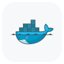

  

<h3 align="center">
  Engineering Expertise & Quantitative Finance 
  <i>Architecting Low-Latency Financial Infrastructures & Stochastic Models</i>
</h3>

    

- 🔭 I’m currently working on **High-Frequency Algorithmic Trading Engines & Real-time Data Pipelines**
- 🌱 I’m currently learning **Stochastic Calculus, Statistical Drives, Distributed Systems Design, & Market Microstructure**
- 👯 I’m looking to collaborate on **Confidential NDA Projets, Open Source Quantitative Analysis Libraries, Telemetry Libraries Scalable Fintech Architectures**
- 📝 I regularly write articles on **Quantitative Finance, System Architecture, & Data Engineering**
- 💬 Ask me about **System Design, C++, Python for Finance, & Derivative Pricing Models**
- 📫 How to reach me **nayanpandit993281@gmail.com**

 

<h3 align="left">🛠 <b>The Arsenal</b></h3>

<table align="center">
  <tr>
    <td align="center" width="90">
      
       Python
    </td>
    <td align="center" width="90">
      
       C++
    </td>
    <td align="center" width="90">
      
       R
    </td>
    <td align="center" width="90">
      
       Matlab
    </td>
    <td align="center" width="90">
      
       AWS
    </td>
    <td align="center" width="90">
      
       Docker
    </td>
    <td align="center" width="90">
      
       SQL
    </td>
    <td align="center" width="90">
      
       TensorFlow
    </td>
  </tr>
</table>

  

 

  

---

### 📊 **Quantifying Impact**

  

 

  

 

  <picture>
    <source media="(prefers-color-scheme: dark)" srcset="https://raw.githubusercontent.com/Nayan991111/Nayan991111/output/snake-dark.svg" />
    <source media="(prefers-color-scheme: light)" srcset="https://raw.githubusercontent.com/Nayan991111/Nayan991111/output/snake.svg" />
    
  </picture>

---

### 📬 **Connect & Collaborate**

  

